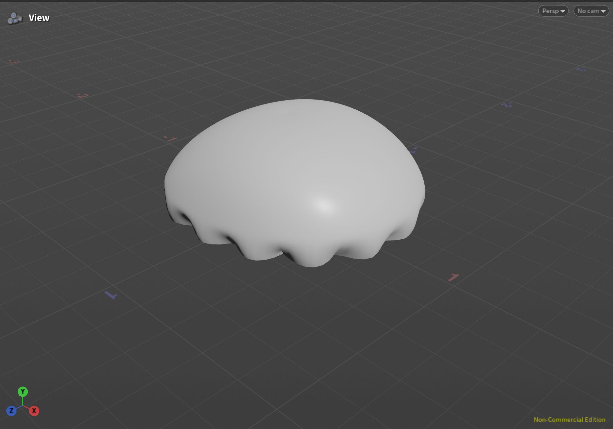
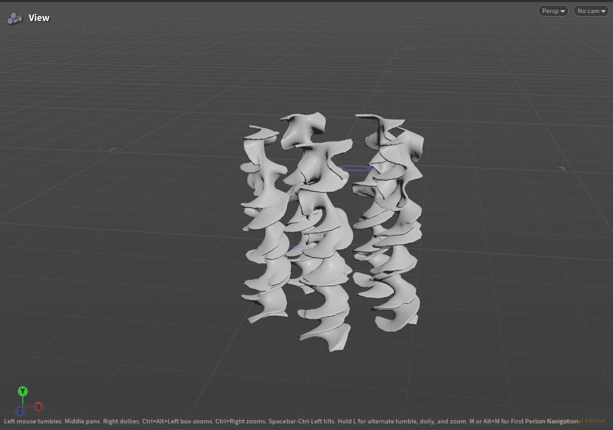
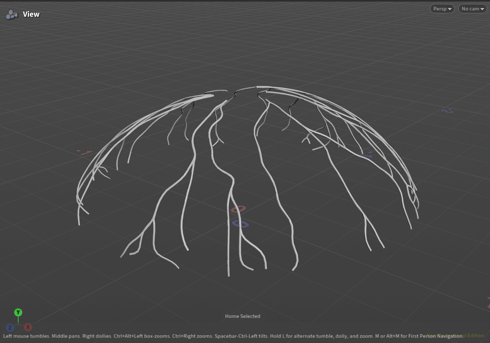
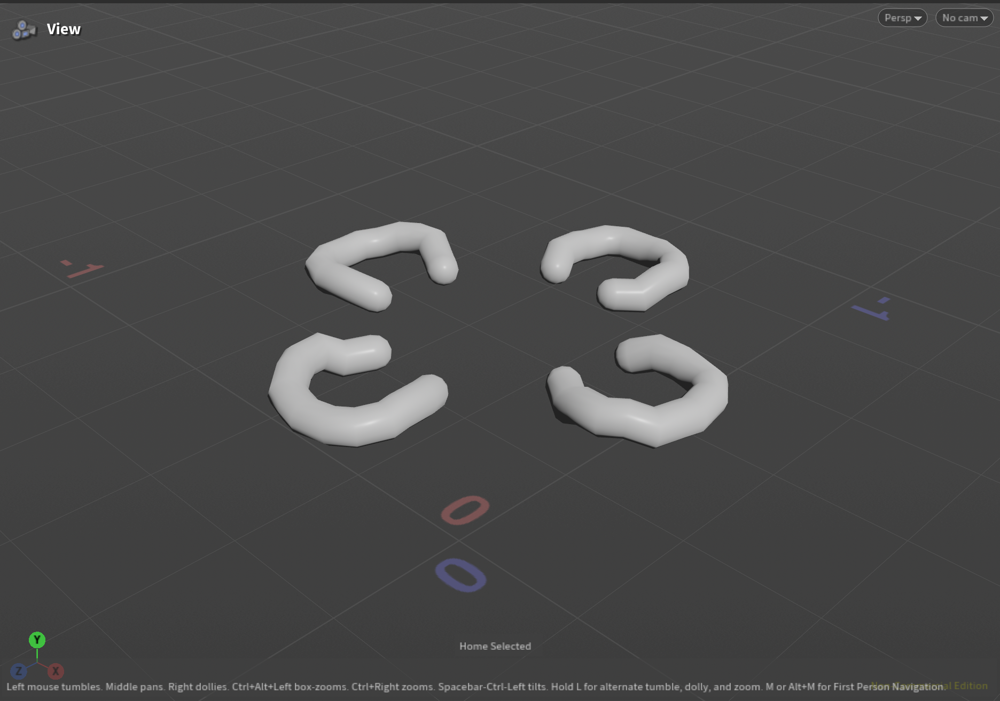
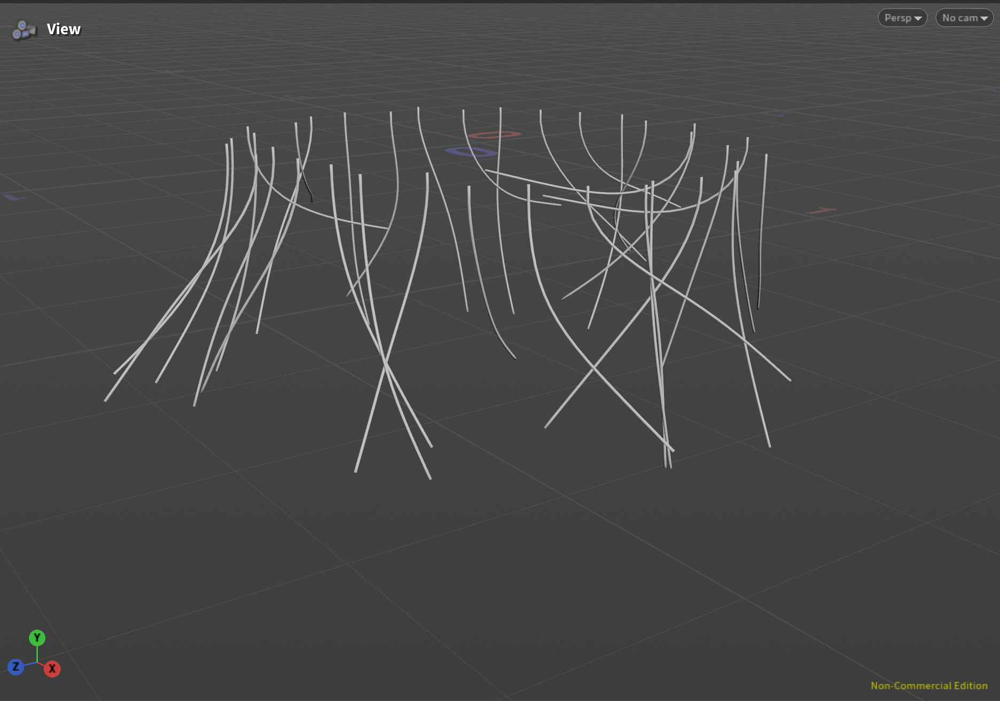
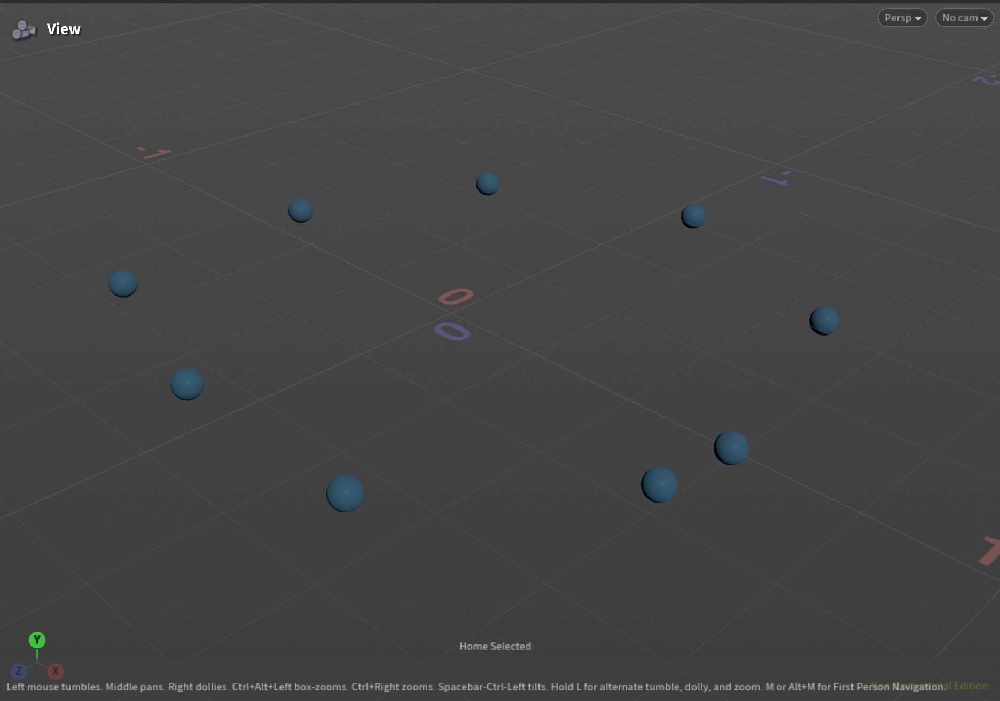
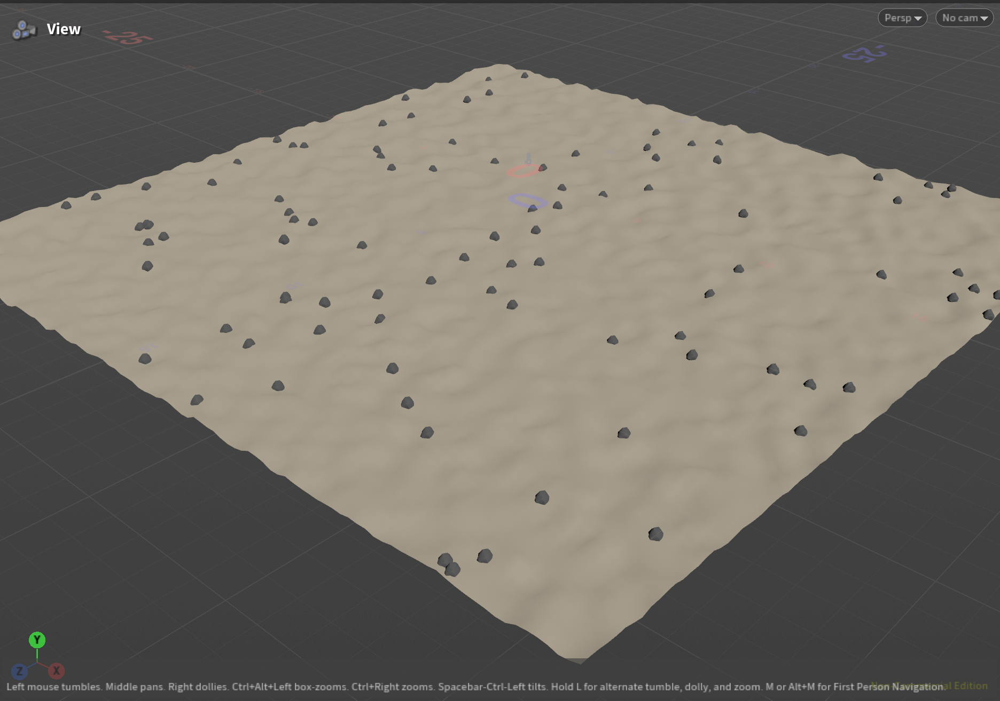

## Zhiyao Luo's Results

**Name:** Zhiyao Luo  
**PennKey:** leoluozy  

---
### Final Result

I created a procedural jellyfish in Houdini with an animated bell, arms, veins, organs, and tentacles. I used Find Shortest Path to generate the veins, Point Deform to attach components to the animated bell, and Vellum Hair to simulate the tentacles.

*Bell*

*Arms*

*Veins*

*Organs*

*Tentacles*

---
### Extra Credit

*SenseBulbs*    
Add another part to your jellyfish: Added sensory bulbs along the bell rim.

*Bell*    
Refine one of the existing parts: Added scalloped edges.  

*Background*  
Add some flair to your scene by adding a background: Created a procedural underwater terrain with scattered rocks.

